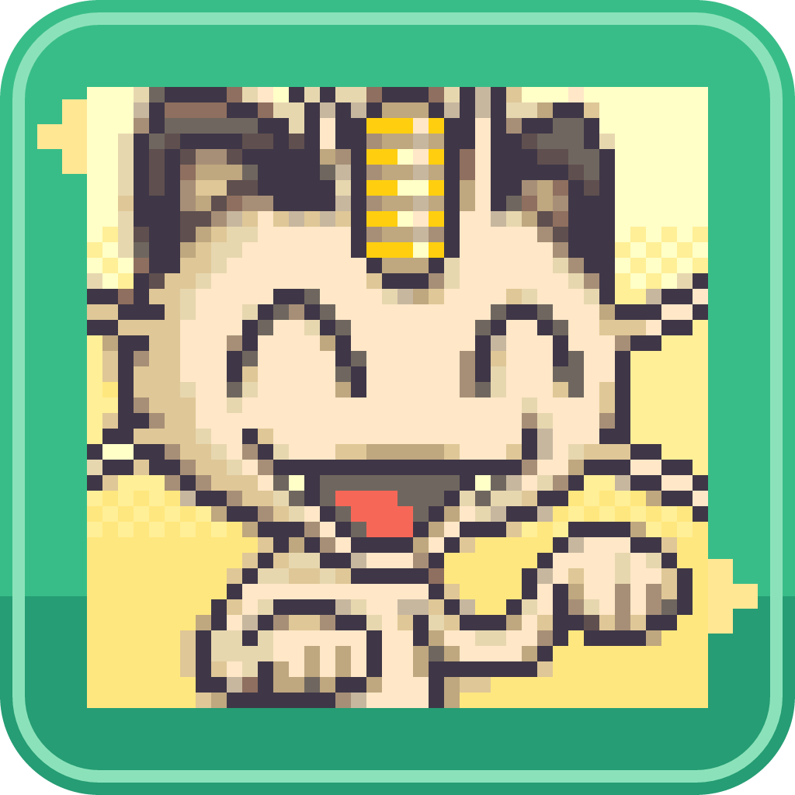
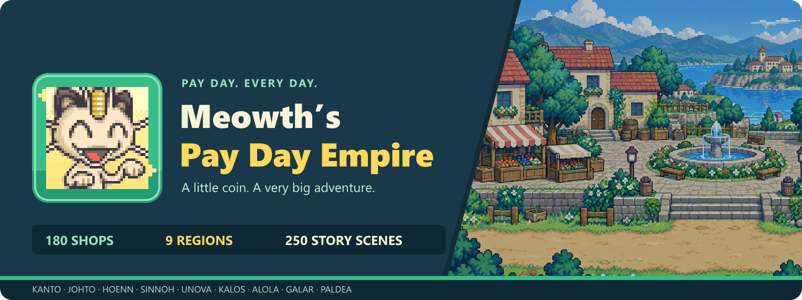
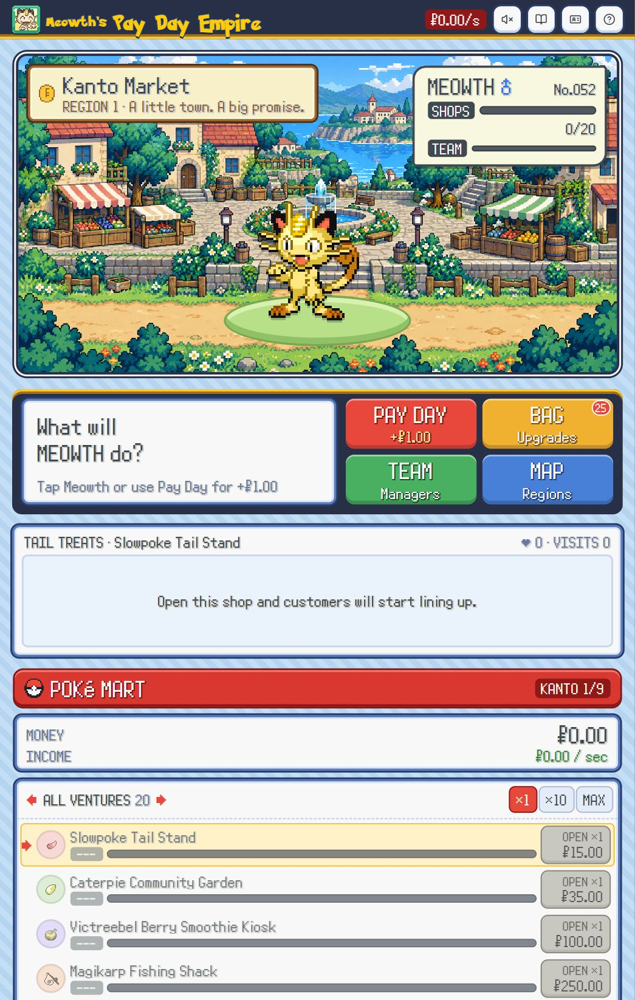

<div align="center">
  

# Meowth’s Pay Day Empire

**A little coin. A very big adventure.**

[](https://github.com/radhepa/Meowths-Payday/actions/workflows/check.yml)
[](https://github.com/radhepa/Meowths-Payday/releases/latest)
[](https://github.com/radhepa/Meowths-Payday/releases/latest)

[**Download for Windows**](https://github.com/radhepa/Meowths-Payday/releases/latest) · [Game guide](docs/GAMEPLAY.md) · [Build it yourself](DESKTOP.md) · [Report a bug](https://github.com/radhepa/Meowths-Payday/issues)



</div>

Start with Meowth, a pocketful of Pokédollars and one Slowpoke Tail Stand. Build a bustling Pokémon business empire, hire your favorite Pokémon, and follow a community adventure from Kanto all the way to Paldea.

## Your next big Pay Day

| 🪙 Grow your empire | 🐾 Bring the town to life | 🗺️ Explore the world |
| --- | --- | --- |
| 100 businesses, bulk buying and 105 upgrades | Pokémon managers, walking customers and little reactions | Nine regions with their own shops and native Pokémon |
| Click Meowth for coins, then put your managers to work | Item-sprite storefronts and expressive PMD portraits | 130 automatic cutscenes across 21 pixel-art settings |
| Two hours of offline income every time you return | Persistent saves with import, export and confirmed reset | Regional milestones carry your empire forward |

## A peek inside the empire



**No connection needed to play.** The Windows app includes the sprites, portraits, fonts, scenery and game data. Updates keep your existing local save. It is designed for a desktop PC.

## Play on Windows

1. Open the [latest release](https://github.com/radhepa/Meowths-Payday/releases/latest).
2. Download the **portable.exe** for a ready-to-run app, or **Setup.exe** for an installer and shortcuts.
3. Launch the game. Use **Pay Day**, buy a stand and hire a manager. The empire starts here!

Your empire saves automatically. **Trainer Card → Options** includes save transfer and **Delete Progress**, with a confirmation before clearing your empire. See the [desktop guide](DESKTOP.md) for save locations and moving to another computer.

## The world tour

| Region | Shops | Story scenes |
| --- | ---: | ---: |
| 🌿 Kanto | 20 | 50 |
| 🍂 Johto | 10 | 10 |
| 🌊 Hoenn | 10 | 10 |
| 🏔️ Sinnoh | 10 | 10 |
| 🌆 Unova | 10 | 10 |
| 🌸 Kalos | 10 | 10 |
| 🌴 Alola | 10 | 10 |
| ⚙️ Galar | 10 | 10 |
| ☀️ Paldea | 10 | 10 |

Travel unlocks through shop, manager, story and earnings milestones. Earlier managers keep working while you explore the next region. New story scenes play automatically; the journal lets you revisit them.

<details>
<summary><strong>Developer backpack — run and build locally</strong></summary>

Use Node.js 22. Install dependencies once; the built game plays offline.

```sh
git clone https://github.com/radhepa/Meowths-Payday.git
cd Meowths-Payday
npm ci
npm run dev
```

```sh
npm test                 # economy, saves, stories and desktop protocol
npm run build            # local web build
npm run desktop:start    # launch the desktop app
npm run desktop:pack     # build Windows portable + installer
```

Built with React, Tailwind CSS, Vite and Electron. All gameplay assets live in `public/assets/`. Desktop packaging lives in `desktop/`; the pure game economy and save rules live in `src/game.js`.

The [Empire checks](.github/workflows/check.yml) workflow tests and builds each change. [Windows treasure chest](.github/workflows/windows.yml) produces desktop downloads when a version tag is pushed or the workflow is started manually.

</details>

## Credits and fan-game notice

An unofficial, noncommercial Pokémon fan game. Pokémon names and artwork belong to their respective rights holders. Sprite and portrait credits, licenses, font sources and upstream histories remain in [the artwork credits](public/assets/CREDITS.md).

- [PokeAPI](https://pokeapi.co/) and [PokeAPI sprites](https://github.com/PokeAPI/sprites) — Pokémon bodies and items.
- [PMD Collab](https://sprites.pmdcollab.org/) — manager portraits and story expressions.
- [Meowth Mint](public/assets/branding/CREDITS.md) — our mint-colored logo, using Meowth’s original Happy portrait.

Maintained by **[radhepa](https://github.com/radhepa)**. [Help the empire grow](CONTRIBUTING.md) · [What’s new](CHANGELOG.md)
